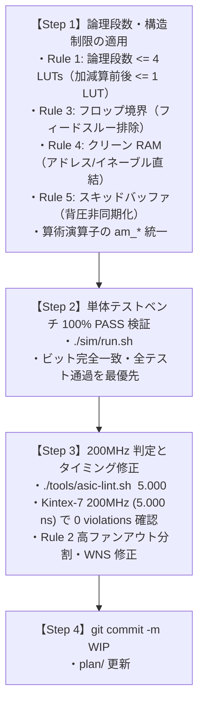

# Agent Guidelines for Amaterrace GPU

このファイルは、再起動後や新規セッション開始時にエージェントが同一の前提知識・制約・進捗状況を把握し、即座に整合性のある作業を継続できるようにするための総合ガイドラインです。

---

## 1. ドキュメント体系と仕様の正本（どこを見ればいいか）

開発・リファクタリング・修正を行う際は、以下のドキュメントを**唯一の正本（Authoritative Specification）**として参照してください。

| ドキュメント | 役割・確認すべき内容 |
| :--- | :--- |
| **`docs/ghci.md`** | **GHCI 1.0 ホスト仕様の絶対的正本**。<br>• Page 0 Slim MMIO（256 バイト、オフセット `0x000`–`0x0FC`、31 レジスタ）<br>• Extended Capabilities（`0x100`–`0x2BC`、全レジスタが最初の 1 KiB / 4 KiB ページ内に収まる）<br>• 不変 Pipeline State Object（PSO, 48 バイト `GhciPipelineState`）<br>• 64-bit コマンドリング、フェンス、割り込みモデル |
| **`include/ghci_regs.vh`**<br>**`include/ghci_regs.h`** | **MMIO レジスタオフセット・ビットフィールドの正本定義**。<br>`GHCI_REG_MAGIC`（`0x000`）〜`GHCI_REG_EXT_CAP_FEATURE`（`0x084`）および拡張機能定義。 |
| **`docs/style.md`** | **ASIC 5nm 1.5 GHz 高周波数アーキテクチャ設計規則・コーディング規約**。<br>• Rule 1: 論理段数予算（標準パス $\le 4$ LUT、加減算前後 $\le 1$ LUT、乗算レイテンシ $\ge 2$）<br>• Rule 2: 高ファンアウト制限（$\le 32$、ツリーバッファリング）<br>• Rule 3: Flop-to-Flop 境界（モジュール境界のフィードスルー排除）<br>• Rule 4: クリーンな単一サイクル RAM パイプライン（アドレス・イネーブルのレジスタ直結）<br>• Rule 5: 背圧非同期化（READY/VALID ハンドシェイクのスキッドバッファ必須化） |
| **`plan/guardrail.md`** | **設計ガードレール**。<br>• Verilog-2005 厳守（SystemVerilog 構文の禁止）<br>• 信号算術演算子（`+`, `-`, `*` 等）は `rtl/library/arith/` 配下に完全隔離（`tools/arith-lint.py` で検証）<br>• 禁止ワード（例: "NGG" は厳格に 0 検出） |
| **`plan/fpga.md`** | **FPGA KC705 実装制約**。<br>• 乗算演算子 `*` 禁止、DSP48E1 直接インスタンス化（`LAT <= 3` での内部パイプライン完全割当）<br>• ファブリック加算器/FF の排除、IP PLL 直結、クロック分周の禁止 |
| **`plan/config.md`** | **Awesome Plan プロジェクト管理**（Workstream / Phase の構成情報） |
| **`plan/queue.md`** | **サブエージェント（P1〜P8）ごとの独立したタスクキュー** |
| **`docs/combination.md`** | **OOC 組み合わせテスト仕様（フル・最小・直交機能・サイズ縮小）** |

---

## 2. 厳格な運用ルール（User Rules & Guardrails）

1. **着手前の提案と承認（Consult Before Acting）**:
   - 実装作業、FPGA ビルド、大規模修正の開始前に、必ず方針・提案を提示してユーザーの明示的な承認を得ること。
2. **Git コミット規則**:
   - コミットメッセージは**厳格に `-m WIP` のみ**を使用すること。詳細なコンテキストや作業内容は `plan/` 配下に記録する。
3. **ストレージモード**:
   - ローカル完結モード。すべての記録は `plan/` 配下に置き、GitHub Issues 等の外部連携は行わない。
4. **Verilog-2005 のみ**:
   - `logic`, `always_ff`, `always_comb`, interface などの SystemVerilog 構文は一切禁止。Verilog-2005 準拠を維持すること。
5. **算術演算子の完全隔離**:
   - `rtl/library/arith/` 以外の RTL コードに生のリテラル算術演算子（`+`, `-`, `*` 等）を記述してはならない（`tools/arith-lint.py --top <mod>` で 0 件必須）。

---

## 3. ホストリソース制約と自動執行メカニズム

ホストマシンの負荷急増を防ぐため、以下の自動制約がシステムおよびスクリプトに組み込まれており、エージェントはこれらを遵守・維持しなければなりません。

### Vivado 実行制約: **ホスト全体で最大 1 プロセス、最大 2 スレッド（スクリプトで完全固定）**
- **スレッド制限（破れないように固定）**:
  - `~/.Xilinx/Vivado/Vivado_init.tcl` および `~/.Xilinx/Vivado/2026.1/Vivado_init.tcl`（および `tools/vivado-cmd.sh` による自動復元）にて以下を強制設定し、さらに `set_param` コマンド自体をフックして `general.maxThreads > 2` や `synth.maxThreads > 1` への引き上げを無効化しています：
    ```tcl
    set_param general.maxThreads 2
    catch {set_param synth.maxThreads 1}
    ```
    ※ `synth.maxThreads 1` により、Vivado 合成時の外部ヘルパープロセス（`task_worker.tcl`, `parallel_synth_helper`）の起動が完全に防止されます。
- **プロセス数制限（同時に 1 つしか起動できないように固定）**:
  - `tools/vivado-cmd.sh` および `~/.local/bin/vivado`（`tools/vivado-cmd.sh` へ委譲）は `flock /tmp/vivado.lock` を用いて排他ロックを取得します。
  - すべての Vivado 関連スクリプト（`asic-lint.sh`, `synth-module.sh`, `vivado-ooc.sh`, `vivado-build.sh`, `vivado-synth-l2.sh`, `ooc-synth.sh`, `build-kc705-ip.sh`）は `tools/vivado-cmd.sh` を経由し、ホスト全体で同時に 1 つの Vivado のみが実行されます。

### ディスク書き込みフラッシュ制約: **Vivado / `vvp` / Linter 実行後は必ず `sync` を実行**
- **背景**: Vivado やシミュレーション（`vvp`）、Linter（`verilator`, `arith-lint.py`, `asic-lint.sh` 等）を連続実行すると、100 GB 規模のダーティページ（書き込み待ちキャッシュ）が蓄積し、システムが不安定になる事象が発生しました。
- **自動執行と義務**:
  - `tools/vivado-cmd.sh`, `~/.local/bin/{vivado,vvp,verilator,python3}`, `sim/run.sh`, `sim/verilator/run.sh`, `tools/lint.sh`, `tools/arith-lint.py`, `tools/asic-lint.sh`, `tools/asic-lint.py`, `tools/py_limit.py` のすべてに `sync`（または `os.sync()` / `trap 'sync' EXIT`）を組み込み済みです。
  - エージェントがワンライナー等で Vivado、`vvp`、各種 Linter を直接呼び出す際も、**呼び出し直後に必ず `sync` コマンドを実行して書き込み完了を待つこと**を厳守してください。

### Python3 実行制約: **最大 3 並列まで**
- **自動制限メカニズム**:
  - `tools/py_limit.py` およびラッパー `~/.local/bin/python3` により、スロットロック `/tmp/amaterrace_py_locks/slot_{0,1,2}.lock` を介して、Amaterrace GPU ワークスペース内の Python プロセスは自動的に最大 3 プロセスに制限され、終了時に `sync` を実行します。
  - `tools/arith-lint.py`, `tools/asic-lint.py`, `tools/run_combination_tests.py` には `py_limit.limit_concurrency(3)` が直接インポートされており、多重防御されています。

---

## 4. ASIC 5nm 1.5 GHz 高周波数化の作業手順（ユーザー指示方針）

モジュールの設計ルール適用およびタイミング収束は、**必ず以下の順序で実施**すること：



> [!IMPORTANT]
> **作業順序の遵守**:
> 最初から 200MHz のタイミングだけを追いかけてはいけません。
> まず**デザインルール（論理段数制限・構造制限）を適用して既存の単体テストベンチが 100% ビット完全一致で通ることを確認**し、テストベンチが通った後に 200MHz（5.000 ns）を達成しているか確認してタイミング修正（ファンアウト分割や段数調整）を行ってください。

---

## 5. モジュール別進捗状況（最新ステータス）

### A. 完了済みモジュール（0 violations, 100% PASS, コミット済み）
1. **`atg_fmt_cvt`** (commit `ae98230`): 0 violations, WNS +1.245 ns, 400k-cycle sim PASS.
2. **`atg_vf_conv`** (commit `83f3c12`): 0 violations, sim PASS.
3. **`atg_mmu`** (commit `f00cb31`): 0 violations, 160 RAMs clean, WNS +1.282 ns, sim PASS.
4. **`atg_dc`** (commit `d3aade1`): 0 violations, 262 RAMs clean, WNS +0.930 ns, 全 6 単体テスト PASS.
5. **`atg_cp`** (commit `8b62415`): 0 violations, WNS +1.013 ns, 全 5 テストスイート PASS.
6. **`atg_vf`** (commit `1d1b930`): 0 violations, WNS +1.016 ns, 全 5 単体テスト PASS.
7. **`atg_blt`** (commit `648d5ef`): 0 violations (Rule 1-5 全 PASS, 126 RAMs clean), WNS +2.143 ns, 359 件テスト 100% bit-exact PASS, DMA 帯域 2007 MB/s (64B) / 1132 MB/s (32B) $\ge 1000$ MB/s.
8. **`atg_rx`** (commit `29867b4`): 0 violations (Rule 1-5 全 PASS), WNS +0.512 ns, 全 10 単体テストベンチ（`scan`, `setup`, `bary`, `clip`, `frag`, `cpoly`, `order`, `pipeline`, `ext_prim`, `fp`）100% PASS, 算術演算子 0 件。
9. **`atg_mc`** (commit `636966e9`): 0 violations (Rule 1-5 全 PASS), WNS +2.438 ns, 全 7 単体テストベンチ（`atg_mc`, `atg_mc_arb`, `atg_mc_atom`, `atg_mc_coalesce`, `atg_mc_l2`, `atg_mc_prot`, `atg_rt`）100% PASS, 算術演算子 0 件。
10. **`atg_rop`** (commit `e8262a9f`): 0 violations (Rule 1-5 全 PASS), WNS +0.924 ns, 全 17 単体テストベンチ 100% PASS, 算術演算子 0 件。
11. **`atg_sa`**: 0 violations (Rule 1-5 全 PASS, 0 warnings), 算術演算子 0 件。
12. **`atg_tu`**: 0 violations (Rule 1-5 全 PASS, 53 RAMs clean), WNS +1.734 ns, 全 12 単体テストベンチ 100% PASS, 算術演算子 0 件。

### B. 作業中モジュール（進行中）
1. **`atg_top` (Chip Top-Level Integration, `rtl/gpu/top/atg_top.v`)**:
   - 算術演算子 0 件達成。`asic-lint.sh atg_top 5.000` の違反解消および統合確認中。
2. **`atg_su` (Shader Execution Unit, `rtl/gpu/su/`)**:
   - 算術演算子 0 件達成、サブモジュール単体テスト 31 本 PASS。`atg_su` 統合テストおよび `asic-lint.sh atg_su 5.000` 対応中。

### C. 未着手の残余モジュール（着手順）
- なし（全モジュール着手済み）

---

## 6. ドキュメント修正タスク（README.md — 完了）

`README.md` に残っていた旧プロトタイプ時代の不整合（Page 0 Slim MMIO 31 レジスタ＋Extended Capabilities、および SU レジスタファイル記述）を修正完了。

---

## 7. 頻出コマンド早見表

```bash
# 1. 単体テストベンチ実行 (ビット完全一致の確認)
./sim/run.sh <module_name>

# 2. 算術演算子リント (必ず --top を指定して特定モジュールを実行)
python3 tools/arith-lint.py --top <module_name>

# 3. ASIC 5nm 1.5 GHz 高周波数ルール検証 (Kintex-7 200MHz / 5.000 ns 代理合成)
./tools/asic-lint.sh <module_name> 5.000

# 4. Git コミット (ルール厳守: 必ず -m WIP)
git add <files>
git commit -m WIP
```
