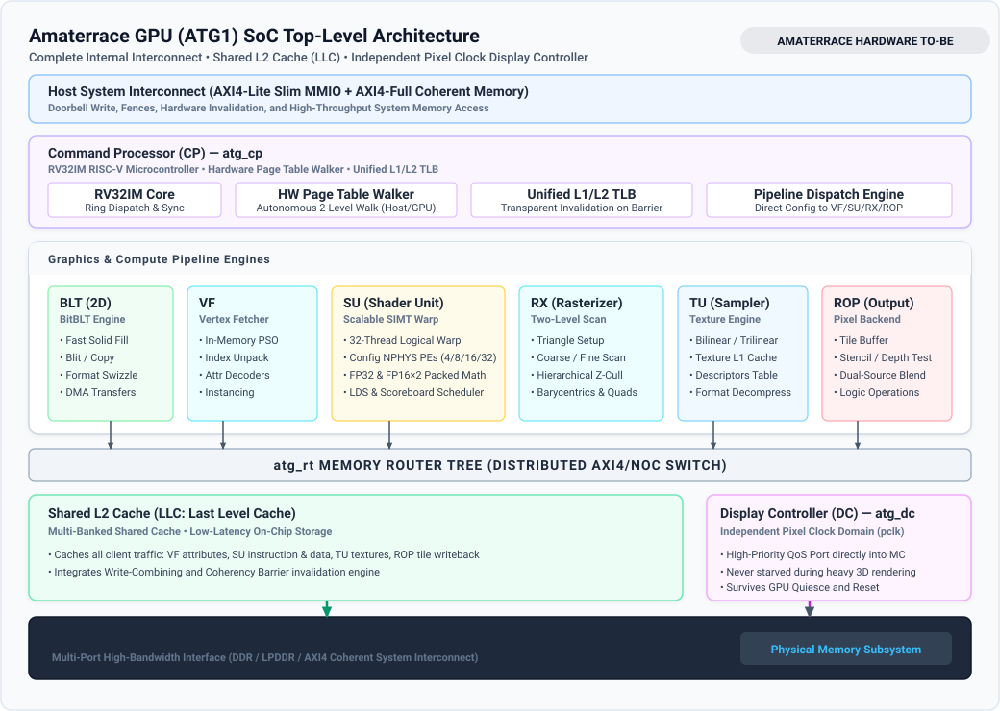
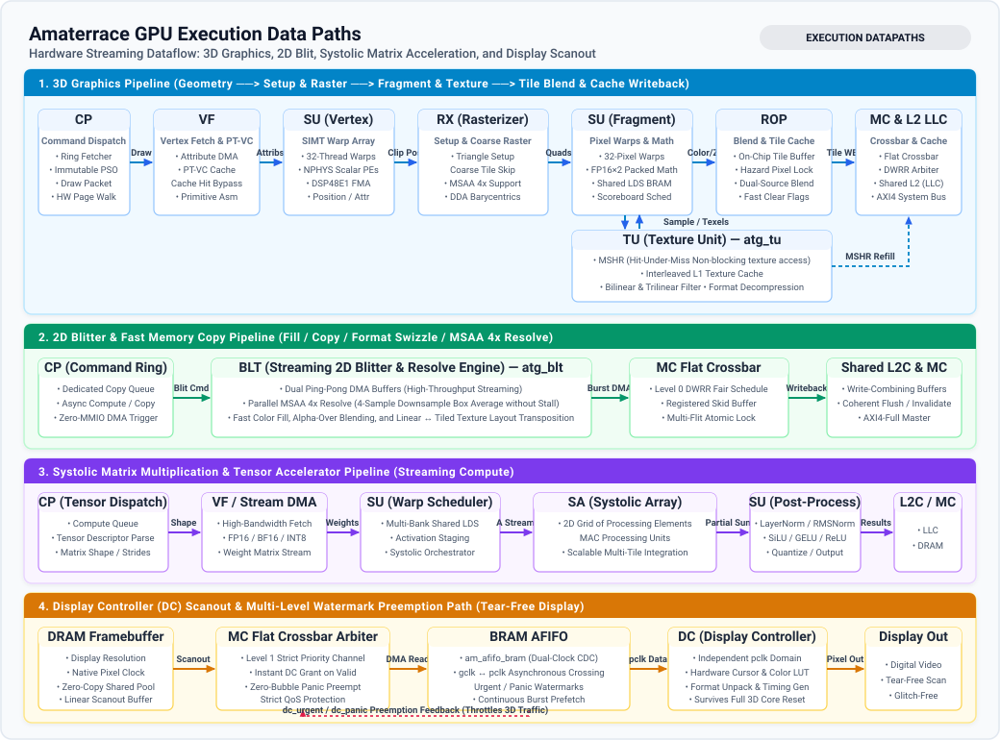
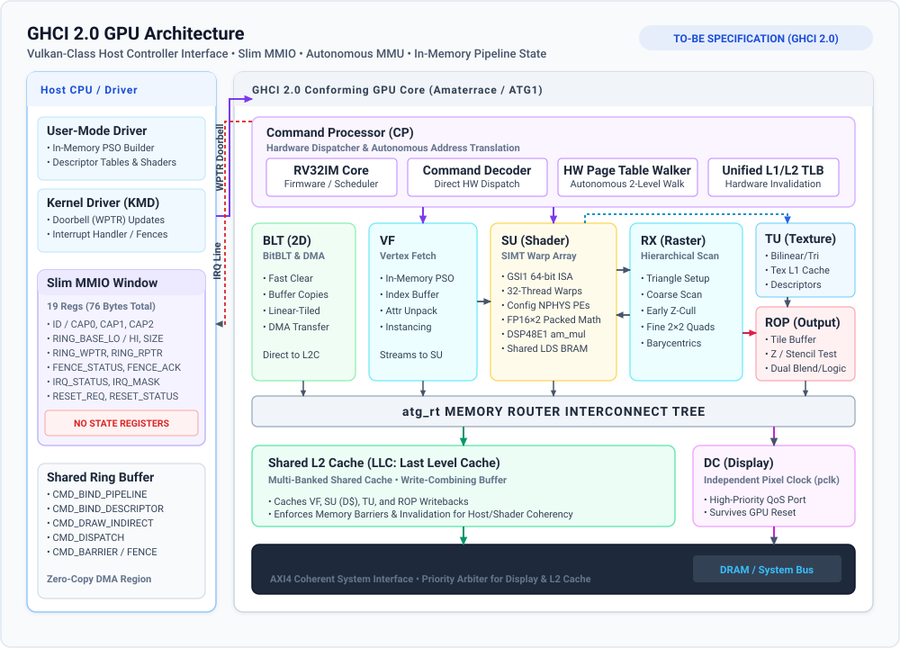
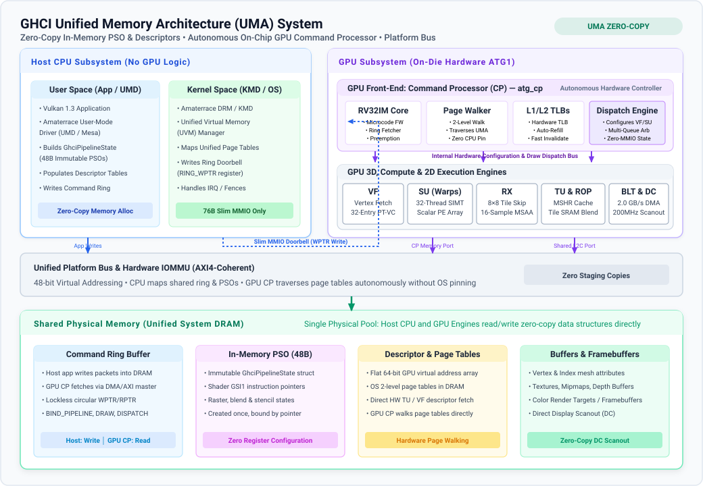
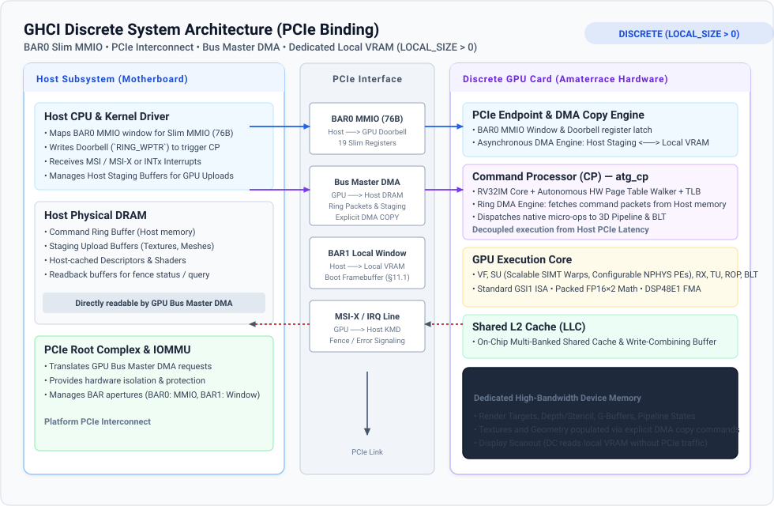
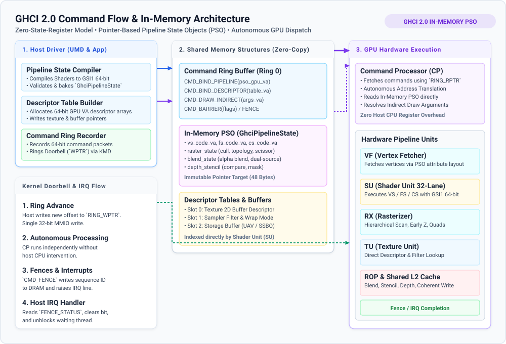
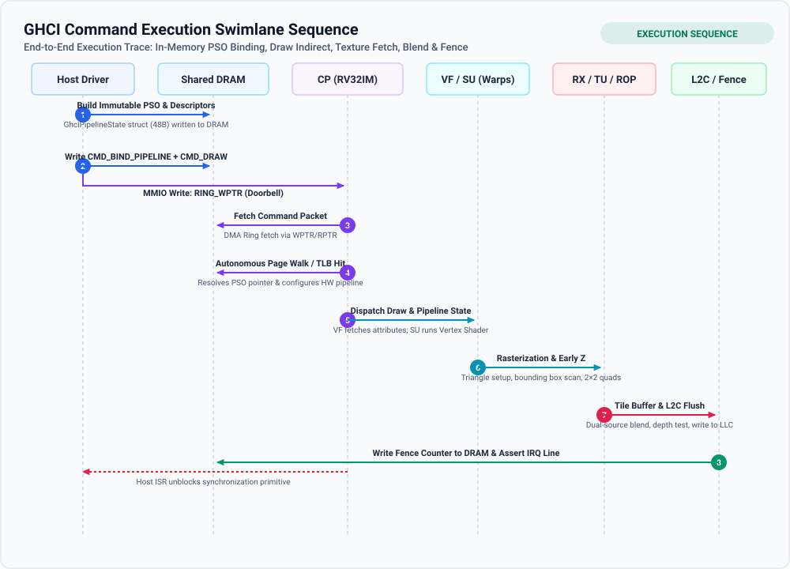
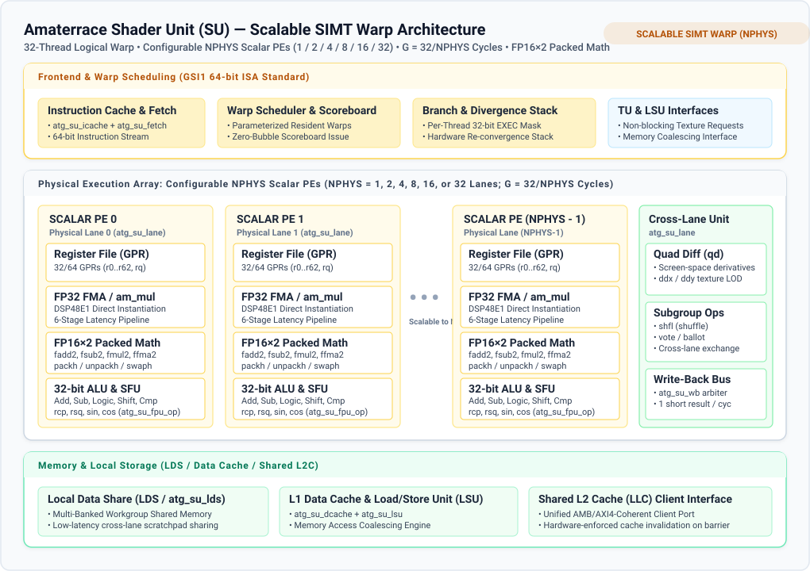
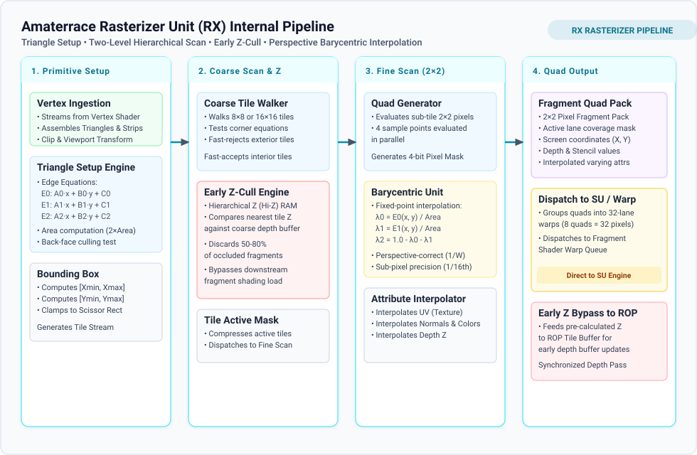
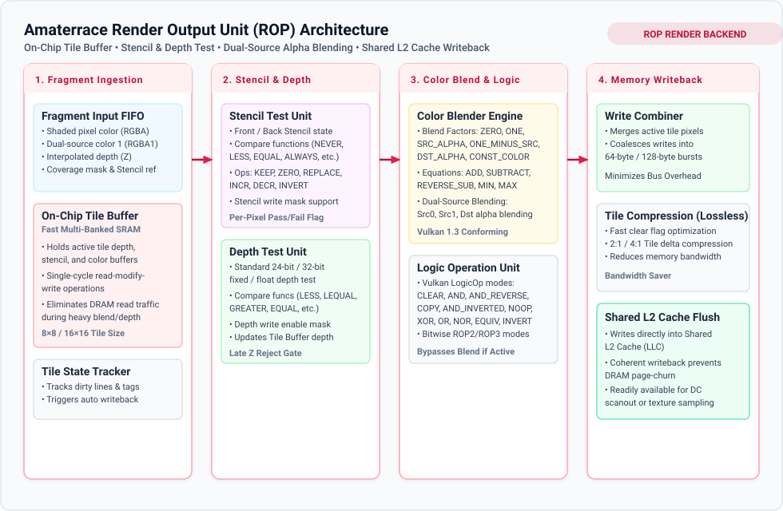

Amaterrace GPU
==============

[](https://github.com/awemorris/amaterrace-gpu/actions/workflows/ci.yml)
[](https://opensource.org/licenses/Zlib)
[](docs/ghci.md)
[](boards/)

Gonna illuminate the world!

---

`Amaterrace GPU` (`ATG1`) is a scalable modern GPU delivering
Vulkan-class graphics and parallel compute, architected to fulfill the
core paradigms and feature sets of Vulkan, DirectX 12, and Metal.  It
proposes [GHCI 1.0](docs/ghci.md), a standardized set of `GPU Host
Controller Interface` and `Shader ISA`.

---

Table of Contents
-----------------

1. [Top-Level Architecture](#1-top-level-architecture)
2. [Execution Data Paths](#2-execution-data-paths)
   - [3D Graphics Pipeline](#3d-graphics-pipeline)
   - [2D Blit & Streaming Copy](#2d-blit--streaming-copy)
   - [Systolic Matrix & Tensor Accelerator](#systolic-matrix--tensor-accelerator)
   - [Display Scanout & QoS Preemption](#display-scanout--qos-preemption)
3. [GHCI 1.0 Host Interface & System Topologies](#3-ghci-10-host-interface--system-topologies)
   - [Unified Memory Architecture (UMA)](#unified-memory-architecture-uma)
   - [Discrete GPU Architecture (PCIe Binding)](#discrete-gpu-architecture-pcie-binding)
   - [MMIO & In-Memory Pipeline State Objects (PSO)](#mmio--in-memory-pipeline-state-objects-pso)
4. [Hardware Blocks & Microarchitecture](#4-hardware-blocks--microarchitecture)
   - [Core Blocks Overview](#core-blocks-overview)
   - [Shader Unit (Scalable SIMT Warp Architecture)](#shader-unit-scalable-simt-warp-architecture)
   - [Rasterizer Unit (RX)](#rasterizer-unit-rx)
   - [Render Output Backend (ROP)](#render-output-backend-rop)
   - [Texture Unit (TU)](#texture-unit-tu)
   - [Memory Hierarchy & Display Subsystem](#memory-hierarchy--display-subsystem)
5. [Building, Simulation & Toolchain](#5-building-simulation--toolchain)
   - [Verification & Linting Tools](#verification--linting-tools)
6. [Repository Structure](#6-repository-structure)
7. [Misc & Trivia](#7-misc--trivia)

---

1. Top-Level Architecture
-------------------------

Amaterrace GPU is partitioned into modular, latency-insensitive processing blocks interconnected by a high-bandwidth internal routing tree (`atg_rt`), converging onto a unified Shared Last-Level Cache (LLC) and memory subsystem:



---

2. Execution Data Paths
-----------------------

Workloads in Amaterrace GPU traverse dedicated, highly optimized hardware streaming pipelines. The diagram below illustrates the four primary execution data paths:



### 3D Graphics Pipeline

```
Host Ring ──> CP (Draw/PSO) ──> VF (PT-VC) ──> SU (Vertex Shader) ──> RX (Setup & Coarse Raster)
                                                                            │
      ┌─────────────────────────────────────────────────────────────────────┘
      ▼
SU (Fragment Shader) <═══> TU (MSHR + L1 Cache)
      │
      ▼
ROP (Tile Buffer & Blend) ──> atg_rt Crossbar ──> Shared L2 Cache (LLC) ──> Memory Subsystem
```

### 2D Blit & Streaming Copy

```
CP (Copy Ring) ──> BLT (Dual Ping-Pong DMA) ──> atg_rt Crossbar ──> Shared L2 Cache ──> Memory Subsystem
```

### Systolic Matrix & Tensor Accelerator

```
CP (Tensor Cmd) ──> VF / Stream DMA (Weights) ──> SU (Warp Stage & LDS) <═══> SA (Systolic Array)
                                                                                     │
                                                    SU (Norm & Activation) <─────────┘
                                                            │
                                                            ▼
                                               Shared L2 Cache & MC ──> Memory Subsystem
```

### Display Scanout & QoS Preemption

```
DRAM Framebuffer ──> MC Priority Arbiter ──> Dual-Clock CDC AFIFO ──> DC (Display Controller) ──> Pixel Out
                              ▲                      │
                              └────── dc_urgent ─────┘ (Instant QoS Preemption)
```

---

3. GHCI 1.0 Host Interface & System Topologies
----------------------------------------------

Amaterrace GPU implements the **GHCI 1.0 (GPU Host Controller Interface)** specification ([docs/ghci.md](docs/ghci.md)). GHCI defines an AHCI/xHCI-style unified programming interface for high-efficiency graphics and parallel compute GPUs.



### Unified Memory Architecture (UMA)

On UMA platforms (integrated SoCs), the host CPU and GPU share physical system DRAM over a coherent system interconnect.

Per GHCI §11.3, unified memory is indicated by `LOCAL_SIZE = 0` (or absence of the `MEM` capability):



- **Autonomous On-Chip Command Processor (CP):** The CP (`atg_cp`) resides strictly on the GPU front-end. It features an RV32IM microcontroller core, an autonomous 2-level hardware page table walker, and unified L1/L2 TLBs.
- **Zero-Copy Pipeline Objects:** Pipeline state structures (`GhciPipelineState`), descriptor tables, vertex arrays, and command rings are accessed directly without staging transfers.
- **Direct Display Scanout:** The display controller scans out directly from the shared framebuffer in system DRAM.

### Discrete GPU Architecture (PCIe Binding)

On discrete GPU platforms, the GPU operates as a PCIe endpoint with dedicated device memory (VRAM).

Per GHCI §11.3, discrete memory is indicated by `LOCAL_SIZE > 0`:



- **Identical Programming Model:** Both UMA and Discrete configurations expose the identical 19 MMIO registers, command ring structures, fence/interrupt models, and GSI1 ISA.
- **Dedicated Local VRAM:** Render targets, depth/stencil buffers, pipeline state objects, and high-frequency textures reside in dedicated local VRAM.
- **Asynchronous DMA Copy Engine:** The GPU's DMA engine stages assets between host DRAM and dedicated local VRAM across PCIe using explicit copy commands (`COPY`).
- **Optional Local Window (BAR1):** An optional host aperture allows firmware (e.g., UEFI GOP or boot console) to write directly to a boot framebuffer without an active driver.

### MMIO & In-Memory Pipeline State Objects (PSO)

GHCI 1.0 eliminates dynamic hardware state registers (`STATE_*`) from MMIO, preventing kernel overhead and bus stalls:

- **19 MMIO Registers (76 Bytes Total):** Identification, capabilities, ring base/size, doorbell write pointer (`RING_WPTR`), read pointer (`RING_RPTR`), fence status, interrupt mask/status, and reset control.
- **In-Memory Immutable PSO:** Render states (rasterization, blend equations, depth/stencil modes, shader program pointers) are baked by the user-mode driver into compact 48-byte structs (`GhciPipelineState`). Commands bind states by passing 64-bit GPU virtual addresses (`CMD_BIND_PIPELINE`).



The swimlane sequence diagram below illustrates the end-to-end command lifecycle:



---

4. Hardware Blocks & Microarchitecture
--------------------------------------

### Core Blocks Overview

| Block   | RTL Module    | Role & Key Microarchitectural Features |
| :---:   | :---          | :---                                   |
| **CP**  | `atg_cp`      | Command Processor: RV32IM core, autonomous 2-level page walker, unified TLBs, lockless ring fetcher |
| **BLT** | `atg_blt`     | 2D Blitter: Dual ping-pong DMA buffers, format conversion, fast solid clear, 4-sample parallel MSAA resolve |
| **VF**  | `atg_vf`      | Vertex Fetcher: Multi-stream DMA attribute unpack, Post-Transform Vertex Cache (PT-VC) primitive assembly |
| **SU**  | `atg_su`      | Scalable SIMT Shader Unit: 32-thread warps, configurable `NPHYS` scalar PEs, FP16×2 packed arithmetic |
| **RX**  | `atg_rx`      | Rasterizer: Triangle setup, hierarchical coarse tile scan, early Z-cull, 2×2 fine quad DDA barycentrics |
| **TU**  | `atg_tu`      | Texture Unit: Non-blocking MSHR cache interface, 4-bank interleaved L1 cache, bilinear/trilinear filtering |
| **ROP** | `atg_rop`     | Render Output Backend: Multi-banked tile buffer, hazard pixel tracking, dual-source blend, logic ops |
| **MC**  | `atg_mc`      | Memory Controller: Coalescing engine, flat crossbar, strict priority display port, shared L2 cache |
| **L2C** | `atg_mc_l2`   | Shared Last-Level Cache (LLC): Multi-banked cache, write-combining buffer, hardware coherency invalidation |
| **DC**  | `atg_dc`      | Display Controller: Independent pixel clock (`pclk`), asynchronous dual-clock CDC AFIFO, tear-free scanout |

---

### Shader Unit (Scalable SIMT Warp Architecture)

The Shader Unit (`atg_su`) executes the standard GSI1 64-bit ISA. It implements a 32-thread logical SIMT warp execution model with parameterizable physical hardware width:



- **Parameterizable Physical Lanes (`NPHYS`):** The physical execution width is configurable at synthesis (`NPHYS = 1, 2, 4, 8, 16, or 32` lanes, with RTL default `NPHYS = 8`). A 32-thread logical warp executes across physical lanes in $G = 32 / \text{NPHYS}$ time cycles.
- **Scalar Processing Elements (Scalar PEs):** Each physical lane is an independent scalar PE (`atg_su_lane`), comprising:
  - **Thread Register File:** 32 or 64 general-purpose 32-bit registers (`r0..r62`, `rq`) per thread.
  - **Integer ALU:** 32-bit add, sub, bitwise logic, shifts, and comparisons (`atg_su_alu`).
  - **Single-Precision FP32 FMA:** Full IEEE-754 single-precision floating-point arithmetic mapped directly to FPGA DSP primitives (`atg_su_fpu`, instantiating DSP48E1 blocks).
  - **FP16×2 Packed Math Unit:** Native half-precision dual operations (`fadd2`, `fsub2`, `fmul2`, `ffma2`, `fmin2`, `fmax2`) alongside conversions (`packh`, `unpackh`, `swaph`) (`atg_su_pk`).
  - **Special Function Unit (SFU):** Reciprocal (`rcp`), reciprocal square root (`rsq`), sine (`sin`), cosine (`cos`), and float square root (`atg_su_fpu_op`).
- **Cross-Lane Operations (`atg_su_lane`):**
  - **Quad Differences (`qd`):** Computes screen-space horizontal and vertical derivatives ($ddx$, $ddy$) within 2×2 pixel quads for texture Level-of-Detail selection.
  - **Subgroup Operations:** Cross-thread data exchange without memory access (`shfl`, `vote`, `ballot`).
- **Local Data Share (LDS):** Workgroup-shared multi-banked scratchpad memory (`atg_su_lds`) enabling zero-conflict data exchange between threads.
- **Scoreboard & Scheduler:** Dependency tracking with parameterizable resident warps, maintaining high throughput across long-latency texture and memory operations.

---

### Rasterizer Unit (RX)

The Rasterizer (`atg_rx`) converts geometric primitives into covered pixel quads:



- **Primitive Setup:** Computes triangle edge equations ($E_0, E_1, E_2$), triangle area, bounding box coordinates, and back-face culling.
- **Hierarchical Coarse Scan:** Evaluates coarse tile corners to fast-reject exterior tiles and fast-accept interior tiles.
- **Early Z-Cull Engine:** Consults hierarchical depth (Hi-Z) RAM to discard occluded geometry prior to shader unit invocation.
- **Fine 2×2 Quad Scan:** Tests sample point coverage, evaluates perspective-correct barycentric coordinates ($1/W$), and interpolates vertex attributes.
- **Warp Assembly:** Collects covered 2×2 quads into 32-thread fragment warps and dispatches them to the Shader Unit.

---

### Render Output Backend (ROP)

The Render Output Backend (`atg_rop`) processes shaded fragment quads and commits pixels to memory:



- **On-Chip Tile Buffer:** Multi-banked fast SRAM holding active tile color, depth, and stencil data for single-cycle read-modify-write operations.
- **Late Depth & Stencil Test:** Performs per-pixel depth comparisons and stencil updates for surviving fragments.
- **Dual-Source Alpha Blending:** Conforms to Vulkan 1.3 blending factors and equations with dual color sources.
- **Lossless Tile Optimization:** Fast clear flag optimization and dirty block state tracking eliminate redundant external write bandwidth.
- **Shared L2 Cache Flush:** Flushes coalesced pixel bursts into the Shared L2 Cache (LLC).

---

### Texture Unit (TU)

The Texture Unit (`atg_tu`) services sampling instructions (`texl`, `texb`, `texf`, `texg`):

- **Non-Blocking MSHR Interface:** Miss Status Holding Registers (MSHRs) track in-flight memory reads, allowing hits under misses without stalling the pipeline.
- **Interleaved Texture L1 Cache:** Multi-banked cache providing single-cycle access to the 2×2 texel footprint needed for bilinear interpolation.
- **Filtering & Decompression:** Hardware bilinear and trilinear filtering with mipmapping, cube maps, array textures, and hardware format unpacking.

---

### Memory Hierarchy & Display Subsystem

- **Shared Last-Level Cache (LLC / `atg_mc_l2`):** Multi-banked on-chip cache shared across all GPU execution clients (VF, SU, TU, ROP, BLT), providing write-combining and hardware coherency invalidation.
- **Memory Controller (`atg_mc`):** Arbitrates client traffic using Deficit Weighted Round Robin (DWRR) and provides burst memory coalescing.
- **Display Controller (`atg_dc`):** Operates on an independent pixel clock (`pclk`) domain. Connects via an asynchronous dual-clock CDC AFIFO with strict Level 1 QoS priority on the memory arbiter (`dc_urgent` and `dc_panic` watermarks), guaranteeing glitch-free display scanout even during heavy GPU saturation or core reset.

---

5. Building, Simulation & Toolchain
-----------------------------------

Running `make` lists all supported build and simulation targets:

```bash
make help          # Show build configuration and target list
make lint          # Run Verilator lint across every module and top-level configuration
make sim-quick     # Fast regression suite across all blocks
make sim           # Comprehensive Icarus Verilog regression suite
make verilator     # System-level cycle-accurate Verilator simulation producing raster output
make check         # Run lint, sim-quick, and verilator in sequence
make vivado        # Run Vivado batch synthesis, place & route, and bitstream generation
make oxc           # Run openXC7 (Yosys + nextpnr) open-source FPGA flow
```

### Verification & Linting Tools

- **Verilator Lint:** `tools/lint.sh` enforces strict `-Wall -lint-only` compliance with **0 warnings**.
- **Arithmetic Linter:** `python3 tools/arith-lint.py` verifies that all signal arithmetic operators (`+`, `-`, `*`, etc.) remain strictly confined to `rtl/library/arith/`, guaranteeing DSP primitive mapping and 0 bare operators.
- **Golden Reference Models:** Reference simulators for rasterization, barycentric interpolation, texture filtering, and floating-point arithmetic are located under `tools/`.
- **Diagram Verification:** `python3 docs/svg/generate_svgs.py` generates and validates all architecture SVG diagrams with 100% compliant XML parsing.

---

6. Repository Structure
-----------------------

```
amaterrace-gpu/
├── rtl/                          # Complete Verilog-2005 Synthesizable RTL
│   ├── bsp/                      # Board Support Packages (generic, xilinx7, pcie)
│   ├── library/                  # Reusable Hardware Infrastructure
│   │   ├── arith/                # Hardware arithmetic (DSP48E1 am_mul, am_add, am_div, am_shift)
│   │   ├── bus/                  # Bus primitives (am_skid, am_afifo_bram, am_axi_master)
│   │   └── fp/                   # IEEE-754 FP32 / FP16 cores (am_fpu_core, am_fp_*)
│   └── gpu/                      # GPU Core Execution Blocks
│       ├── cp/                   # Command Processor (RV32IM, multi-queue, page walker)
│       ├── blt/                  # 2D Blitter & MSAA 4x Resolve Engine
│       ├── vf/                   # Vertex Fetcher & Post-Transform Vertex Cache (PT-VC)
│       ├── su/                   # Scalable SIMT Shader Unit & Scalar PEs
│       ├── rx/                   # Hierarchical Rasterizer (Coarse Tile, Fine Scan, DDA Bary)
│       ├── tu/                   # Texture Unit (MSHR, Interleaved Cache, Sampler)
│       ├── rop/                  # Render Output Backend (Tile Buffer, Hazard Lock, Blend)
│       ├── mc/                   # Memory Controller (Flat Crossbar, Coalescer, Shared L2 LLC)
│       ├── dc/                   # Display Controller (Independent pclk, AFIFO, Digital Video)
│       └── top/                  # SoC Top-Level Integrations (atg_top, atg_kc705_top)
├── boards/                       # Board Top-Level Wrappers & Constraints (Xilinx KC705)
├── docs/                         # Specifications & Architectural Documentation
│   ├── ghci.md                   # GHCI 1.0 Specification & GSI1 Shader ISA Standard
│   ├── style.md                  # Verilog-2005 Coding Standard & Guardrails
│   └── svg/                      # Vector Architecture & Datapath Diagrams (11 SVGs)
├── fw/cp/                        # Command Processor Firmware (C / Assembly for RV32IM)
├── include/                      # Shared RTL Verilog Headers & C Definitions
├── plan/                         # Awesome Plan Local-Only Project Management Records
├── sim/                          # Testbenches & Simulation Harnesses
│   ├── tb/                       # Directed Unit Testbenches (Icarus Verilog)
│   ├── verilator/                # Full-System C++ Cycle-Accurate Verilator Harness
│   └── vectors/                  # Golden Test Vectors & Geometry Datasets
├── spec/                         # Formal Module Specifications (One per RTL module)
└── tools/                        # Compilers, Linters, and Golden Reference Simulators
```

---

7. Misc & Trivia
----------------

- The name `Amaterrace` comes from the Japanese Mythology.
- The entire SoC that uses `Amaterrace GPU` and [Sukuna RISC](https://github.com/awemorris/sukuna-risc/) is named `Moonphaser`.
