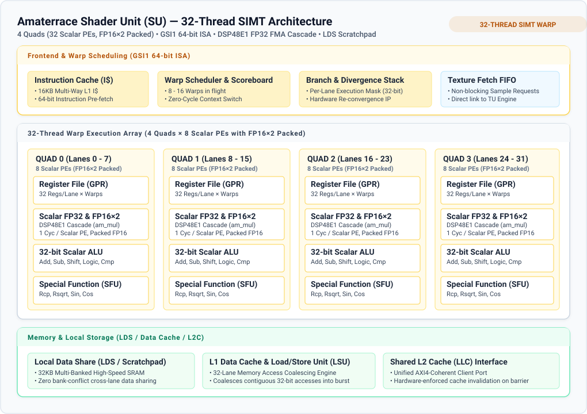

Amaterrace GPU
==============

[](https://github.com/awemorris/amaterrace-gpu/actions/workflows/ci.yml)

`Amaterrace GPU` is an RTL GPU implementation.

It is designed for mobile graphics targeting at least 1920x1080 @ 60fps,
and furthermore, it scales up to 100 TOPS as an LLM accelerator.

- **Host interface:** [GHCI](docs/ghci.md), a standard host controller interface for Vulkan-class GPUs that this project proposes.
- **Shader ISA:** GSI1, the GHCI standard ISA (RISC-V based, 64-bit encoding; [docs/ghci.md section 12](docs/ghci.md#12-the-standard-shader-isa-gsi1)).
- **Target:** Xilinx KC705 (XC7K325T) at 200 MHz; 800 MHz is the goal on ASIC processes.
- **License:** Zlib (the same as zedBSD), including the GHCI specification.

Contents
--------

1. [Architecture](#architecture)
2. [GHCI 2.0 Host Interface](#ghci-20-host-interface)
3. [Blocks & Implementation Details](#blocks--implementation-details)
   - [Shader Unit (SIMT Warp Architecture)](#shader-unit-simt-warp-architecture)
   - [Rasterizer Unit (RX)](#rasterizer-unit-rx)
   - [Render Output Backend (ROP)](#render-output-backend-rop)
   - [Shared L2 Cache & Display Controller](#shared-l2-cache--display-controller)
4. [Status](#status)
5. [Building and testing](#building-and-testing)
6. [Repository layout](#repository-layout)

Architecture
------------

Amaterrace GPU (device `ATG1`) is a Vulkan-class graphics processing unit
implementing the GHCI 2.0 specification. The diagram below illustrates the
top-level SoC architecture, internal interconnects, shared last-level caching,
and memory subsystems:


### Data Paths

- **Fill / Copy:** `CP --> BLT --> atg_rt --> Shared L2 Cache --> MC`
- **Graphics Pipeline:**
  ```
  CP --> VF --> SU --> RX --> SU --> ROP --> atg_rt --> Shared L2 Cache --> MC
                              |
                              +--> TU
  ```
- **Matrix / LLM Accelerator:**
  ```
  CP --> VF --> SU --> SA --> SU --> SA -> ... --> SU --> ROP --> Shared L2C --> MC
  ```

Internal blocks communicate through a tree of distributed routers (`atg_rt`),
converging into a unified **Shared L2 Cache (LLC)** (512 KiB – 2 MiB) that
buffers vertex attributes, shader memory, texture lookups, and tile writebacks.
The **Display Controller (DC)** operates in its own independent 200 MHz pixel clock
domain with a dedicated high-priority QoS bypass port directly into the Memory
Controller (MC), preventing scanout stutter or starvation even during GPU quiesce
or full reset.

GHCI 2.0 Host Interface
-----------------------

Amaterrace GPU is driven through the **GHCI 2.0 (GPU Host Controller Interface)**
specification ([docs/ghci.md](docs/ghci.md)), designed for modern zero-copy
virtual memory OS architectures:


### System Topologies (UMA & Discrete)

GHCI 2.0 provides an identical programming model for both Unified Memory
Architecture (UMA) and Discrete PCIe graphics devices:

| Topology | Architecture Diagram | Key Characteristics |
| --- | --- | --- |
| **Unified Memory (UMA)** |  | Shared physical DRAM pool; hardware page table walker & L1/L2 TLBs in CP; zero-copy pipeline states, descriptors, and display framebuffers. |
| **Discrete GPU (PCIe)** |  | BAR0 76-byte Slim MMIO window; Bus Master DMA engine; dedicated high-bandwidth VRAM with on-board Shared L2 Cache. |

### Command Submission & In-Memory Pipeline State

GHCI 2.0 introduces a zero-register-traffic command architecture:


- **Slim MMIO Interface:** Dynamic state registers (`STATE_*`) are eliminated.
  The host interface contains only 19 registers (76 bytes) for ring pointers
  (`WPTR`/`RPTR`), fence synchronization, interrupts, and power/reset control.
- **In-Memory Immutable PSO:** Shaders, rasterizer configuration, and blend
  parameters are baked into immutable `GhciPipelineState` structures (48 bytes)
  allocated in user-space memory.
- **Autonomous CP Execution:** The Command Processor traverses page tables and
  configures the pipeline directly without generating MMIO bus traffic.

The swimlane sequence diagram below illustrates the end-to-end command lifecycle:


Blocks & Implementation Details
-------------------------------

| Block | Name | Role |
| --- | --- | --- |
| **CP** | Command Processor | RV32IM RISC-V core running firmware; hardware 2-level page table walker; unified L1/L2 TLB; ring fetcher and hardware dispatch engine. |
| **BLT** | Blitter | 2D fast fill, copy (with optional alpha-over), linear↔tiled copy for textures, and resolve of multisampled images. |
| **VF** | Vertex Fetcher | Autonomous descriptor fetch, index and vertex attribute parsing, instancing, and primitive assembly. |
| **SU** | Shader Unit | 32-thread SIMT compute core with scalar PEs (FP16×2 packed support) executing vertex, fragment, and compute warps (GSI1 64-bit ISA). |
| **RX** | Rasterizer | Triangle setup, coarse tile scan, hierarchical early-Z cull, fine 2×2 quad scan, and perspective barycentric evaluation. |
| **TU** | Texture Unit | Sampler with texture L1 cache: 2D, 2D array, 3D, and cube maps with mipmapping; bilinear and trilinear filtering; format decompression. |
| **ROP** | Render Output Backend | Fast on-chip Tile Buffer, stencil and depth tests, dual-source color blending, logic operations, and coherent Shared L2 Cache writeback. |
| **L2C** | Shared L2 Cache | Multi-banked unified cache (512 KiB – 2 MiB) with write-combining and barrier-driven invalidation. |
| **SA** | Systolic Array | 32 × 32 matrix multiplication engine for LLM acceleration, offering 0.8 TOPS per SU at 200 MHz. |
| **MC** | Memory Controller | Internal AMB bus arbiter with AXI4 master interfacing host DRAM or local VRAM. |
| **DC** | Display Controller | Independent 200 MHz pixel clock domain; direct high-priority scanout port to MC; HDMI/DVI scanout surviving GPU reset. |

### Shader Unit (SIMT Warp Architecture)

The Shader Unit executes the standard GSI1 ISA with a 32-thread SIMT warp
architecture. Each lane is a 32-bit scalar Processing Element (scalar PE) with
FP16×2 packed arithmetic support, organized into 4 Quads (8 scalar lanes per Quad):



- **Execution Array:** 32 scalar Processing Elements (PEs) across 4 Quads:
  Quad 0 (0–7), Quad 1 (8–15), Quad 2 (16–23), and Quad 3 (24–31). Each lane operates
  as a scalar execution pipeline executing 1 thread of the 32-thread warp (subvectored across `NPHYS` physical lanes).
- **Scalar FP32 & Packed FP16×2:** Each scalar lane integrates a dedicated
  FP32 fused multiply-add pipeline (`am_mul`), cascaded across Xilinx DSP48E1
  slices for single-cycle throughput, with packed FP16×2 execution for double-rate half-precision math.
- **Local Data Share (LDS):** 32 KiB on-chip multi-banked scratchpad memory for
  low-latency cross-lane communication and compute group sharing without bank
  conflicts.
- **Scoreboard & Scheduler:** Per-warp hardware scoreboard tracks long-latency
  operations (memory, texture, transcendental) across 8–16 concurrent warps with
  zero-cycle switching overhead.

### Rasterizer Unit (RX)

The Rasterizer converts primitives into covered pixel quads through a
high-throughput two-level hierarchical pipeline:


1. **Triangle Setup & Bounding Box:** Generates edge equations ($A \cdot x + B \cdot y + C$),
   computes double-area ($2 \times \text{Area}$), performs back-face culling, and clamps
   bounding boxes to the scissor rectangle.
2. **Coarse Scan & Early Z-Cull:** Walks $8\times 8$ or $16\times 16$ coarse tiles.
   The **Early Z-Cull Engine** evaluates hierarchical Z (Hi-Z) RAM against the
   bounding box, discarding 50–80% of occluded geometry before fragment shading.
3. **Fine Scan (2×2 Quads):** Evaluates sub-tile $2\times 2$ pixel fragments with
   perspective-correct barycentric interpolation ($\lambda_0, \lambda_1, \lambda_2$)
   and sub-pixel precision ($1/16\text{th}$).
4. **Quad Output:** Bundles covered fragments with interpolated varyings (UV,
   normals, colors, depth) into 32-pixel fragment warps dispatched directly to SU.

### Render Output Backend (ROP)

The Render Output Backend processes shaded fragment quads and commits pixels to memory:


- **On-Chip Tile Buffer:** Multi-banked SRAM tile cache holding active color,
  depth, and stencil data for single-cycle read-modify-write operations,
  eliminating off-chip bus contention during heavy blending.
- **Stencil & Depth Test:** Full Vulkan 1.3 compare operations and stencil ops
  (KEEP, ZERO, REPLACE, INCR, DECR, INVERT) with independent write masks.
- **Color Blending & Dual-Source:** Conforming color blender supporting standard
  modes (Add, Subtract, Reverse Sub, Min, Max) and **Dual-Source Blending**
  ($\text{Src0}, \text{Src1}, \text{Dst}$).
- **Logic Operations:** Hardware implementation of all 16 Vulkan LogicOp modes
  and bitwise ROP2/ROP3 functions.
- **Shared L2C Writeback:** Lossless tile compression and write-combining buffers
  flush pixel data directly into the Shared L2 Cache.

### Shared L2 Cache & Display Controller

- **Last-Level Cache (LLC):** Sits directly in front of the Memory Controller,
  coalescing memory traffic from VF, SU, TU, ROP, and BLT.
- **Independent Display Domain:** The Display Controller operates on an isolated
  200 MHz pixel clock domain and connects directly to an unthrottled high-priority
  QoS port on the Memory Controller, guaranteeing tear-free display scanout even
  during GPU stress tests, quiesce cycles, or hardware resets.

Status
------

The RTL is being completed block by block. Correctness comes first, in
simulation; timing closure at 200 MHz comes later.

| Block | State |
| --- | --- |
| CP (with its RV32IM control core and firmware), BLT, MC | Implemented |
| DC | Implemented |
| RX, ROP | Implemented; triangles, lines and points with depth, stencil and blending match the reference model in simulation |
| SU | Integer, fp32, memory, LDS and control paths implemented, in simulation |
| VF | Implemented, in simulation |
| SU graphics paths (export, primitive table), TU | Implemented; the textured scenes match the reference model in simulation |
| 4x multisampling (RX, SU, ROP, TU, BLT resolve) | Implemented; the scene matches the reference model in simulation |
| Vulkan 1.0 core rendering (stencil, depth bias, bounds and clamp, points and lines, four colour attachments, the required formats, ETC2 and EAC, occlusion queries) | Implemented; the scene matches the reference model in simulation |
| SA | Deferred until the SU implements the whole ISA |

The whole pipeline targets the KC705. The KC705 is driven over USB JTAG for
now; PCIe comes later.

Building and testing
--------------------

`make` alone lists the targets. The defaults are `BOARD=kc705`,
`TOP=atg_kc705_top` and `PART=xc7k325tffg900-2`.

| Command | What it does |
| --- | --- |
| `make lint` | Verilator lint of every module and top |
| `make sim` | The Icarus Verilog unit testbenches, every one at full length (about 21 minutes) |
| `make sim-quick` | A short run of the testbenches that touches every block (about 9 minutes): the long ones shortened or left out, as `sim/run.sh` lists |
| `make verilator` | The Verilator system harness in the KC705 shape, including a raster scene written to `build/verilator/raster.png` |
| `make check` | `lint`, `sim` and `verilator` |
| `make oxc-core` | openXC7 (yosys) synthesis of the GPU core in the KC705 shape |
| `make oxc` | openXC7 synthesis, place and route, and bitstream |
| `make vivado` | Vivado batch build |
| `make prog-oxc`, `make prog-vivado` | Load the bitstream with openFPGALoader |

Tools: Vivado 2026.1 (batch, BASIC license), openXC7, Icarus Verilog,
Verilator, and openFPGALoader or OpenOCD for JTAG.  `tools/fw-build.sh` and
`tools/cpu-tests.sh` take clang from `CLANG_BIN`, by default
`../zedBSD-claude1/build/llvm/bin` beside the repository; from a checkout
elsewhere (a git worktree) pass `CLANG_BIN`.

GitHub Actions runs `make lint`, `make sim` and `make verilator`, plus the
openXC7 synthesis of the GPU core in the KC705 shape, on every push and pull
request to `main`.

Repository layout
-----------------

| Path | Contents |
| --- | --- |
| [rtl/](rtl/) | `bsp/{generic,xilinx7}/`, `library/{arith,bus,fp}/`, `gpu/{cp,blt,vf,rx,su,tu,rop,sa,mc,dc,top}/` |
| [spec/](spec/) | One specification per module: ports, behaviour, and what its testbench checks |
| [include/](include/) | RTL constants and the shared C headers |
| [fw/cp/](fw/cp/) | Firmware of the command processor's control core |
| [boards/](boards/) | Board tops and constraints for the KC705 (Vivado projects, IP output products and bitstreams are not committed) |
| [sim/](sim/) | Icarus Verilog unit testbenches, the Verilator system harness, and test vectors |
| [tools/](tools/) | The assembler, the ISA and raster reference models, vector generators, and the lint and build scripts |
| [docs/](docs/) | The GHCI specification (with the GSI1 shader ISA) and the coding style |

Misc
----

The name `Amaterrace` comes from a Japanese goddess.
The reduced version is named `Moonphaser`.
