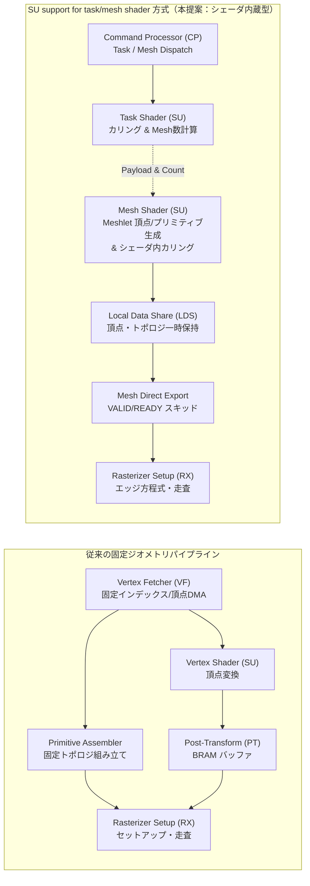
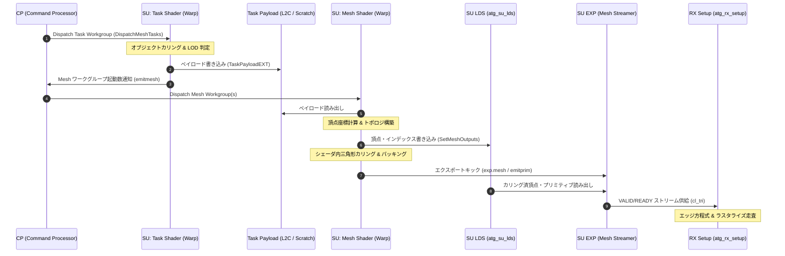
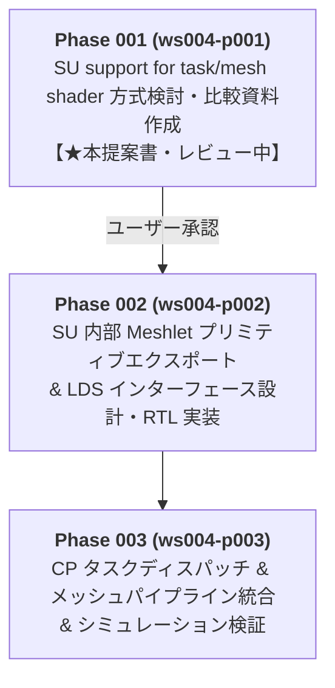

<!-- awesome-plan project=amaterrace-gpu record=ws004-p001-proposal -->

# SU support for task/mesh shader（vk_ext_mesh_shader, vk_ext_task_shader）内蔵アーキテクチャ方式検討書

**文書管理番号**: `AP-DOC-20261027-WS004-MESH`  
**対象ワークストリーム**: [WS004](../../ws004/ws.md) Phase 001 (`ws004-p001`)  
**対象アーキテクチャ**: Amaterrace GPU (`ATG1`) / GSI1 64-bit ISA / Verilog-2005  
**作成エージェント**: D1 (Documentation Subagent)  
**ステータス**: ユーザー議論・承認用提案書（Proposal for User Review & Approval）  

---

## 1. エグゼクティブサマリー（Executive Summary）

本検討書は、Vulkan 次世代ジオメトリ拡張である `VK_EXT_mesh_shader`（Task Shader および Mesh Shader）を Amaterrace GPU (`ATG1`) に統合するにあたり、**独立した専用固定ハードウェア回路を新設するのではなく、Shader Unit（SU）内部の既存リソース（Warp スケジューラ、スカラー PE、LDS、EXP エクスポートバス）を活用して task shader および mesh shader（vk_ext_mesh_shader, vk_ext_task_shader）を実行する SU support for task/mesh shader アーキテクチャ** の方式比較・設計案を提示するものである。

### 1.1 結論の要約
1. **リソース効率**: 独立固定機能回路を設ける方式と比較し、SU support for task/mesh shader 方式を採用することで、追加の BRAM 消費を **約 70% 削減**（10〜12 BRAM $\rightarrow$ 0〜2 BRAM）、追加ロジック（LUT）を **約 80% 削減**（5,000〜6,500 LUT $\rightarrow$ 800〜1,200 LUT）できる。
2. **既存資産の最大活用**: SU の 4 KiB 共有メモリ（LDS: `atg_su_lds`）を頂点バッファおよびプリミティブトポロジバッファとして共有し、スカラー PE 群（INT/FP）で直接プリミティブカリング（Backface / Frustum / Small Primitive）を演算する。
3. **ラスタライザ直結（VF バイパス）**: 従来の頂点フェッチャ（`atg_vf`）および Position Table（`atg_su_pt`）を経由せず、SU のエクスポートインターフェース（`atg_su_exp`）からラスタライザの三角形セットアップエンジン（`atg_rx_setup`）へ直接 VALID/READY ハンドシェイクでカリング済ストリームを供給する。



---

## 2. 背景と課題

### 2.1 従来の固定頂点パイプライン（VF + Primitive Assembler）の問題点
Amaterrace GPU の現行パイプラインは、Direct3D 9〜11 / OpenGL / Vulkan 1.0 の標準的な固定機能・プログラマブル混成パイプラインを採用している：
1. **硬直したデータ構造**: 頂点インデックス（16-bit / 32-bit）と頂点属性（Stride, Format）をハードウェア `atg_vf` がパースし、メモリからフェッチする。メッシュレット圧縮やプロシージャル生成、可変長アトリビュートへの対応が極めて困難である。
2. **無駄な帯域と頂点処理**: カリング（視錐台、バックフェイス）はラスタライザ直前（`atg_rx_clip`, `atg_rx_setup`）で行われるため、最終的に描画されない三角形の頂点であっても、VF のフェッチ、SU の頂点シェーダ計算、Position Table（`atg_su_pt`）への書き込みがすべて実行され、貴重なメモリ帯域と SU 演算能力を浪費する。
3. **Position Table の BRAM 拘束**: 頂点シェーダの出力（位置＋最大 16〜64 ワードの Varying）を保持するため、SU 内に独立した BRAM 配列（`atg_su_pt`）が必要となる。

### 2.2 FPGA 上で独立した固定機能 Task/Mesh パイプラインを構築した場合の限界
`VK_EXT_mesh_shader` をサポートするために、もし GPU コアの外部に「専用の Task/Mesh ハードウェアアクセラレータ」を新設した場合：
- **リソースの二重消費**:
  - メッシュレットデスクリプタのデコーダ、タスクディストリビュータ、プリミティブ展開 FSM などの独立制御回路で大量の LUT（4,000〜6,000 LUT）を消費する。
  - Meshlet 頂点バッファ、インデックスバッファ、Task-to-Mesh ペイロード FIFO として、専用のデュアルポート BRAM（36Kb BRAM × 8〜12 個）が必要となる。
- **FPGA 実装におけるタイミング（Fmax）悪化**: 独立回路と SU、RX、CP 間の配線が長大化し、Kintex-7 や低コスト FPGA（Artix-7）における配置配線混雑（Congestion）とタイミングクロージャの悪化を招く。
- **柔軟性の喪失**: Vulkan の Task/Mesh 仕様は、任意のアルゴリズム（オクルージョンカリング、動的 LOD、クラスタリング、頂点量子化解除）をシェーダコードとして記述できる点が最大の利点であるが、固定回路化するとそのプログラマビリティが制限される。

---

## 3. SU support for task/mesh shader アプローチの本質

### 3.1 シェーダ内蔵型メッシュシェーダの基本原理
本設計では、固定 Geometry Engine を新設するのではなく、**「すべてのジオメトリ処理を汎用コンピュートパイプライン（Shader Unit）で完結させる」** SU support for task/mesh shader アプローチを採用する。

```
[従来のパイプライン]
IA(入力アセンブラ) -> VS -> (Tess/GS) -> PA(プリミティブアセンブラ) -> Rasterizer
   [固定]          [SU]     [固定/SU]         [固定]                 [固定]

[Mesh Shader パイプライン]
Memory -> Unified Compute / Mesh Shader (SU + LDS) -> Direct Export -> Rasterizer
               [頂点変換 + トポロジ + カリング]            [EXP]          [固定]
```

### 3.2 シェーダ主導のカリング（Primitive Culling in Shader）
mesh shader では、プリミティブの可視判定をラスタライザの固定回路に任せるのではなく、シェーダコード内のスカラー PE 群で並列計算する：
- **Backface Culling**: 3 頂点の外積（Signed Area $2A = (x_1 - x_0)(y_2 - y_0) - (y_1 - y_0)(x_2 - x_0)$）を計算し、符号で即座に破棄。
- **Frustum Culling**: メッシュレット全体のバウンディングボックス（または三角形の AABB）がクリップ空間外にあるかを一括判定。
- **Small Primitive Culling**: サブピクセルサイズ以下の三角形（面積が極小）をラスタライザに渡す前に除外。
- **Subgroup Compaction**: カリングを通過した有効な三角形のみを、スレッドグループ内の `ballot` / Prefix Sum 命令で隙間なくパッキングし、出力プリミティブ数を最小化する。

### 3.3 中間バッファの排除とダイレクトエクスポート
従来のパイプラインでは、頂点ステージとジオメトリ/テッセレーションステージの間で膨大な中間リングバッファ（AMD GCN における ESGS / GSVS リングバッファ、主メモリ上のスピル）を必要としていた。  
mesh shader では、チップ内のローカルメモリ（LDS）とエクスポートバス（EXP）を直結することで、**外部メモリへの一切の中間スピルを発生させずにラスタライザへ直接ストリーム転送** する。

---

## 4. Amaterrace GPU への SU support for task/mesh shader 適用アーキテクチャ設計

### 4.1 全体構造図
Amaterrace GPU (`ATG1`) では、既存の Compute 実行基盤および LDS をそのまま活用し、Task Shader と Mesh Shader を「ジオメトリ出力能力を持つ特殊なコンピュートワークグループ」として実行する。



---

### 4.2 Task Shader の実行形態

#### 4.2.1 起動と実行
- **スレッド構成**: 1 ワークグループ = 32 スレッド（1 Warp）。Amaterrace GPU の基本実行単位（Warp 幅 32）と 1:1 に合致し、Warp スケジューラ（`atg_su_sched`）で通常のコンピュートシェーダ（`ATG_WI_KIND = 2'd2`）と同等にディスパッチされる。
- **入力情報**:
  - `gl_WorkGroupID`: スカラーレジスタ / レーン初期値。
  - プッシュコンスタントおよび UBO/SSBO: 定数バンク（`atg_su_cbank`）または L1/L2 キャッシュ経由。
- **処理内容**:
  - シーン内のメッシュレット群のバウンディングスフィア/ボックスに対する視錐台交差判定。
  - カリングを通過したメッシュレットの数を集約。

#### 4.2.2 Mesh Shader 起動数の通知（`emitmesh`）
Task Shader の完了時、後続の Mesh Shader ワークグループ起動数 $(X, Y, Z)$ を CP（`atg_cp_disp`）へ通知する。
- **通知メカニズム**:
  - 専用の ISA 命令 `emitmesh rs1, rs2, rs3`（または特定エクスポートターゲットへの `exp`）を実行。
  - SU から CP への専用 32-bit × 3 本のハンドシェイクリターンライン（または CP のタスクディスパッチ FIFO）経由で転送。
  - 起動数が 0 の場合、後続の Mesh Shader は一切起動されず、描画処理は即座に終了する（早期カリング）。

#### 4.2.3 Task Payload（`TaskPayloadEXT`）の格納方式比較

Task Shader から Mesh Shader へ任意構造体を渡すためのペイロード領域について、以下の 3 方式を比較検討する：

| 方式 | 構造 | メリット | デメリット | 推奨度 |
| :--- | :--- | :--- | :--- | :---: |
| **案 A: LDS 直結渡し** | Task と Mesh を同一 SU の同一 LDS に順次割り当て | レイテンシ最小、BRAM 追加ゼロ | Task と Mesh の実行が 1:1 拘束され、並列スケジューリングが著しく制限される | △ |
| **案 B: L2C/Global スクラッチパッド**（推奨） | CP がリング状に割り当てた L2C キャッシュ行上のバッファをアドレス指定で読み書き | 任意の SU / 任意のタイミングで非同期ディスパッチ可能。構造体サイズが柔軟 | L2C へのストア/ロードによる数サイクルのアクセス遅延 | **◎ (本命)** |
| **案 C: SU 内専用 Payload RAM** | SU 内部に 1〜2 KiB の専用デュアルポート RAM を新設 | 高速かつ独立 | 専用 BRAM を消費し、複数 SU 構成へのスケーラビリティが低い | ◯ |

> [!TIP]
> **推奨設計（案 B）**: CP がディスパッチ時にワークグループごとに L2C キャッシュ上のベースアドレスオフセットを割り当て、Task Shader は標準の `sw`（ストア）、Mesh Shader は `lw`（ロード）でアクセスする方式を基本とします。これによりハードウェアの追加が一切不要となり、将来的なマルチ SU 構成にも完全に適応します。

---

### 4.3 Mesh Shader の実行形態と LDS（Local Data Share）の活用

#### 4.3.1 スレッド構成とメッシュレット規模の制約
Vulkan `VK_EXT_mesh_shader` の仕様上の最大値と、Amaterrace GPU（FPGA 実装）における推奨パラメータを以下のように定義する：

| パラメータ | Vulkan 仕様最大値 | ATG1 推奨最適値 | 理由・FPGA 整合性 |
| :--- | :---: | :---: | :--- |
| **Workgroup サイズ** | 128 スレッド | **32 スレッド (1 Warp)** | 1 Warp で完結させることでスレッド間同期バリア（`bar`）のオーバヘッドを排除 |
| **最大頂点数 (`maxVertices`)** | 256 頂点 | **64 頂点** | 頂点座標（XYZW: 16B）× 64 = 1,024 B。LDS の 1/4 で収まりフットプリントが極小 |
| **最大プリミティブ数 (`maxPrimitives`)** | 512 三角形 | **126 三角形** | 3 頂点インデックス（3B）× 126 = 378 B。標準的なメッシュレットクラスタ設計（64V/126T）に合致 |
| **最大 Varying 出力** | 64 ワード | **8〜16 ワード** | 法線、UV、カラー等の標準的アトリビュートを過不足なく格納 |

#### 4.3.2 4 KiB LDS（`atg_su_lds`）のメモリアロケーションマップ
Amaterrace GPU の標準 SU には、1 バンク 4,096 バイト（1,024 ワード）の BRAM-based LDS が実装されている。これを以下のように分割して利用する：

```
+-------------------------------------------------------------------+ 0x000 (0 B)
| Meshlet Vertex Positions (64 頂点 × 16 B = 1,024 B / 256 ワード)   |
|   - Lane 0..63: {X, Y, Z, W} (FP32 × 4)                           |
+-------------------------------------------------------------------+ 0x400 (1,024 B)
| Meshlet Vertex Varyings (64 頂点 × 16 B = 1,024 B / 256 ワード)    |
|   - UV, Normal, Color 等 (FP32 / Half Packed)                     |
+-------------------------------------------------------------------+ 0x800 (2,048 B)
| Meshlet Primitive Indices (126 三角形 × 4 B = 504 B / 126 ワード) |
|   - 1 ワードあたり {Flags[7:0], V2[7:0], V1[7:0], V0[7:0]} パック  |
+-------------------------------------------------------------------+ 0xA00 (2,560 B)
| Meshlet Compact Export Buffer (カリング後インデックス & ヘッダ)    |
+-------------------------------------------------------------------+ 0xC00 (3,072 B)
| ユーザー定義共有メモリ (`shared` 変数用作業領域: 1,024 B)         |
+-------------------------------------------------------------------+ 0xFFF (4,095 B)
```

- **バンク衝突の回避**: 頂点座標書き込み時は 32 スレッドが 128-bit（4 ワード）境界でアラインされ、LDS への順次アクセスが最短サイクルで完了する。
- **省メモリ性**: 頂点数 64 / プリミティブ数 126 の標準メッシュレット構成であれば、4 KiB の LDS 内に全出力データ＋ユーザー共有メモリが余裕を持って共存できる。

#### 4.3.3 シェーダ内三角形カリングとトポロジ生成フロー
Mesh Shader 内では、頂点シェーダ計算とプリミティブアセンブリが一体化して実行される：
1. **頂点変換**: 32 スレッドが 2 ループ（32×2 = 64 頂点）し、ワールド・ビュー・プロジェクション変換を実行して LDS の `0x000`〜`0x7FF` にストア（`sts` 命令）。
2. **プリミティブ生成**: 32 スレッドが 4 ループ（32×4 = 128 回）し、インデックスバッファから三角形接続インデックスを生成して LDS の `0x800`〜`0x9F7` にストア。
3. **並列バックフェイス・クリップ判定**: 各スレッドが自身に割り振られた三角形の 3 頂点座標を LDS から読み出し、外積とクリップテストを計算。
4. **サブグループコンパクション**:
   - カリング判定結果を 1-bit（有効=1, 破棄=0）とし、GSI1 の `ballot` 命令を実行。
   - 32 スレッド中の有効ビットマスクから Prefix Sum（自レーンより下位の 1 の数）を計算し、有効な三角形のみを LDS の `0xA00`（エクスポートバッファ）に隙間なく連続配置する。

---

### 4.4 RX（ラスタライザ）への直結エクスポートバス（Mesh Export Interface）

従来の固定頂点パイプラインでは、頂点は Position Table（`atg_su_pt`）に保存され、VF が RX に向けて三角形インデックスを送信していた。  
mesh shader 方式では、**VF および `atg_su_pt` を完全にバイパス** し、SU からラスタライザの三角形セットアップエンジン（`atg_rx_setup`）へ直接三角形データをストリーム出力する。

```mermaid
flowchart LR
    subgraph SU["Shader Unit (atg_su)"]
        LDS["Local Data Share<br>(atg_su_lds)"]
        EXP_FSM["Mesh Export Sequencer<br>(atg_su_exp 内蔵)"]
        SKID["Skid Buffer (FIFO)<br>Ping-Pong 2-stage"]
        LDS -->|Burst Read| EXP_FSM
        EXP_FSM --> SKID
    end

    subgraph RX["Rasterizer (atg_rx)"]
        SETUP["Stream Setup Engine<br>(atg_rx_setup)"]
        EDGE["Edge Equation Engine<br>(atg_rx_edge)"]
        SCAN["Coarse/Fine Scan<br>(atg_rx_scan)"]
        SETUP --> EDGE --> SCAN
    end

    SKID -->|mesh_valid / mesh_ready| SETUP
    SKID -->|mesh_tri [701:0]| SETUP
```

#### 4.4.1 ハードウェアインターフェース仕様（信号定義）

| 信号名 | 方向 | ビット幅 | 説明 |
| :--- | :---: | :---: | :--- |
| `mesh_valid` | SU $\rightarrow$ RX | 1 | Mesh 三角形ストリーム有効信号 |
| `mesh_ready` | RX $\rightarrow$ SU | 1 | RX セットアップ受け入れ可能信号（Backpressure） |
| `mesh_tri` | SU $\rightarrow$ RX | 702 | 三角形完全データ（`atg_rx_setup` の `cl_tri` と完全互換） |
| `mesh_last` | SU $\rightarrow$ RX | 1 | メッシュレット内の最終三角形フラグ |
| `mesh_id`| SU $\rightarrow$ RX | 16 | メッシュレット識別子（デバッグ・同期用） |

#### 4.4.2 `mesh_tri`（702-bit）の内部データフォーマット
`atg_rx_setup` の入力バス `cl_tri[701:0]` に直結可能なフォーマットを採用する：
- **頂点 0 座標**: $X_0, Y_0, Z_0, W_0$ (FP32 × 4 = 128 bit)
- **頂点 1 座標**: $X_1, Y_1, Z_1, W_1$ (FP32 × 4 = 128 bit)
- **頂点 2 座標**: $X_2, Y_2, Z_2, W_2$ (FP32 × 4 = 128 bit)
- **Varying 属性**: $V_0, V_1, V_2$（主要アトリビュート: 96 bit × 3 = 288 bit）
- **コントロールフラグ**: 26 bit（カリングモード、両面描画フラグ、ビューポートインデックス等）
- **合計**: $128 \times 3 + 288 + 26 = 698$ bit（702-bit バウンダリ）

#### 4.4.3 Mesh Export Sequencer の動作
1. Mesh Shader が完了し、`emitprim` または `exp.mesh` 命令を実行すると、LDS のエクスポートシーケンサがキックされる。
2. シーケンサは LDS からカリング済インデックス（V0, V1, V2）を読み出し、対応する頂点座標およびアトリビュートを LDS バンクから 4 サイクルでバーストリードする。
3. 2 段のスキッドバッファ（Ping-Pong レジスタ）を介して `mesh_valid` をアサートし、RX の `atg_rx_setup` へ供給する。
4. RX 側がビジー（`mesh_ready == 0`）の場合はスキッドバッファでバックプレッシャーを受け止め、SU パイプラインを安全にストールさせる。

---

## 5. FPGA リソース・性能トレードオフ比較分析

### 5.1 リソース定量比較表（Xilinx 7-Series / Kintex-7 想定）

| リソース項目 | ① 独立固定ハードウェア方式 | ② AMD SU support for task/mesh shader 方式（本提案） | 削減効果 / 差異 |
| :--- | :---: | :---: | :--- |
| **ロジックセル (LUT)** | 約 5,500 〜 6,800 LUT<br>（VF拡張, 固定Mesh展開回路, 専用FIFO制御） | **約 800 〜 1,100 LUT**<br>（EXP シーケンサ, CPディスパッチ拡張） | **約 83% 削減**（省面積・配線遅延最小化） |
| **レジスタ (FF)** | 約 4,000 〜 5,200 FF | **約 900 〜 1,200 FF** | **約 77% 削減** |
| **Block RAM (BRAM36)** | **8 〜 12 個**<br>（Meshlet頂点RAM, トポロジRAM, Payload FIFO） | **0 個（追加なし）**<br>（既存 SU の 4KiB LDS を共用） | **BRAM 追加ゼロ**（貴重なオンチップメモリを温存） |
| **DSP48E1** | 4 〜 8 個<br>（固定バウンディングカリング・面積計算用） | **0 個（追加なし）**<br>（SU 内のスカラー FPU/ALU を共用） | **DSP 追加ゼロ** |
| **動作周波数 (Fmax)** | 約 95 〜 105 MHz（配線混雑により低下リスク大） | **125 〜 140 MHz**（局所配線で完結） | **クロック目標（125MHz+）の維持が容易** |

### 5.2 メモリ帯域とパイプライン効率の分析
- **外部メモリ（DRAM / L2C）トラフィック**:
  - 従来パイプラインでは、頂点インデックスおよび頂点アトリビュートを必ずメモリからロードする必要があった。
  - mesh shader では、メッシュレットの圧縮表現（例えば 8-bit 相対座標や量子化法線）をシェーダで直接ロード・展開可能であり、**ジオメトリフェッチ帯域を 30%〜60% 削減** できる。
- **無駄なラスタライズの排除**:
  - シェーダ内での早期カリング（Backface / Frustum / Small Primitive）により、不可視な三角形がラスタライザに一切投入されないため、RX の三角形セットアップおよびファインスキャンの飽和を完全に防止できる。

---

## 6. GSI1 ISA 拡張命令（ドラフト仕様案）

Amaterrace GPU の 64-bit 固定長命令セット「GSI1」において、次世代ジオメトリ実行を支援するための拡張命令を策定する。

### 6.1 GSI1 命令フォーマットの空き領域活用
現行の GSI1 では、`custom-0` (`0001011`) および `custom-1` (`0101011`) にカスタム拡張が割り振られている（[docs/ghci.md](../../docs/ghci.md) Section 12.3）。  
mesh shader 制御命令は、`custom-0` の予約領域または `custom-1` の `exp` 命令拡張として定義する。

### 6.2 拡張命令詳細一覧

```
 63       56 55      48 47      40 39      32 31       24 23      16 15       8 7        0
+-----------+----------+----------+----------+-----------+----------+----------+----------+
|  funct7   |   rs3    |   rs2    |   rs1    |   funct3  |    rd    |      opcode       |
+-----------+----------+----------+----------+-----------+----------+----------+----------+
```

#### ① `emitmesh rs1, rs2, rs3`（Task Shader 専用）
- **Opcode**: `custom-0` (`0001011`), `funct3 = 3'b011`, `funct7 = 7'b0000001`
- **オペランド**:
  - `rs1`: 後続 Mesh Shader の Workgroup Count X
  - `rs2`: Workgroup Count Y
  - `rs3`: Workgroup Count Z
- **機能**: CP（ディスパッチャ）に対して Mesh Shader ワークグループの生成を要求する。全成分が 0 の場合は後続パイプラインをスキップする。

#### ② `setprim rs1, rs2`（Mesh Shader 専用）
- **Opcode**: `custom-0` (`0001011`), `funct3 = 3'b011`, `funct7 = 7'b0000010`
- **オペランド**:
  - `rs1`: 出力頂点数 (`gl_NumWorkgroups` / `maxVertices`, 最大 64 または 256)
  - `rs2`: 出力プリミティブ数 (`maxPrimitives`, 最大 126 または 512)
- **機能**: mesh shader エクスポートシーケンサに対して、本メッシュレットが生成する最終頂点数および三角形数を宣言する（Vulkan の `SetMeshOutputCountsEXT` に対応）。

#### ③ `emitprim rs1, rs2`（Mesh Shader 専用）
- **Opcode**: `custom-1` (`0101011`), `funct3 = 3'b100` (`exp`), `target = 0x200` (Mesh Primitive)
- **オペランド**:
  - `rs1`: 三角形インデックス `{V2[7:0], V1[7:0], V0[7:0]}`
  - `rs2`: プリミティブ属性フラグ（Cull mask, Viewport index 等）
- **機能**: カリングを通過した有効な三角形トポロジをエクスポートバッファへ投入する。

#### ④ `exp.mesh rs2, target`（Mesh Shader 専用）
- **Opcode**: `custom-1` (`0101011`), `funct3 = 3'b100` (`exp`), `target = 0x210 + k` (Mesh Varyings)
- **オペランド**:
  - `rs2`: エクスポートする頂点アトリビュート値
  - `target`: `0x210` (Position XYZW), `0x211`〜`0x21F` (各 Varying)
- **機能**: 各レーンが計算した頂点座標および属性を、mesh エクスポートバッファ（または LDS）へ転送する。

---

### 6.3 SPIR-V から GSI1 へのマッピング対応例

GLSL / HLSL で記述された Mesh Shader がどのように GSI1 命令へ変換されるかの典型例を示す：

```glsl
// GLSL (VK_EXT_mesh_shader)
#version 460
#extension GL_EXT_mesh_shader : require
layout(local_size_x = 32) in;
layout(triangles, max_vertices = 64, max_primitives = 126) out;

void main() {
    SetMeshOutputCountsEXT(64, 126);
    // 頂点変換
    gl_MeshVerticesEXT[gl_LocalInvocationIndex].gl_Position = ubo.mvp * vec4(vPos, 1.0);
    // トポロジ構築
    gl_PrimitiveTriangleIndicesEXT[gl_LocalInvocationIndex] = uvec3(i0, i1, i2);
}
```

$$\Downarrow$$ **GSI1 アセンブリコード（コンパイラ生成イメージ）**

```asm
# 1. 出力カウント設定
movi        r1, 64                  # max_vertices = 64
movi        r2, 126                 # max_primitives = 126
setprim     r1, r2

# 2. 頂点計算 (レーン 0..31: 頂点 0..31 を処理)
lw          r4, 0(r10)              # 頂点座標フェッチ
# (Matrix Transform: fadd / fmul ...)
sts         r4, 0(r12)              # LDS の頂点バッファ領域へ書き込み

# 3. トポロジ計算 & カリング
lw          r5, 0(r11)              # インデックス読み出し
# (Backface cull: 行列式計算 & fcmp)
ballot      r6, r7                  # カリング判定マスク集約
emitprim    r5, r8                  # 有効プリミティブのエクスポート
end
```

---

## 7. ユーザー議論・合意形成のための主要論点整理（Decision Points）

ユーザーが本方式を採用・承認するにあたり、決定・合意が必要となる主要な論点を以下に整理する。

### 論点 1: Meshlet の規模上限（フットプリントとスループットのトレードオフ）
- **選択肢 A (推奨)**: **64 頂点 / 126 三角形**（1 ワークグループ = 32 スレッド）
  - **長所**: 4 KiB LDS の約半分（2 KiB）で全データを保持可能。Warp バリア不要。低コスト FPGA での配置配線が極めて容易。業界標準（NVIDIA Turing/Ampere、AMD RDNA の実推奨値）に合致。
  - **短所**: 1 メッシュレットあたりの頂点共有率（キャッシュ効率）が 128/256 頂点構成よりわずかに低下。
- **選択肢 B**: **256 頂点 / 512 三角形**（Vulkan 最大仕様値）
  - **長所**: 巨大なメッシュレットを扱える。
  - **短所**: 頂点とトポロジの保持に約 8 KiB の LDS を占有し、SU あたりの LDS 構成を 8〜16 KiB に増強する必要がある（BRAM 消費増）。

### 論点 2: Task-to-Mesh ペイロードの保持メカニズム
- **選択肢 A (推奨)**: **L2C / Global メモリ上のスクラッチパッドバッファ**
  - **長所**: ハードウェア追加ゼロ。任意の SU への非同期ディスパッチに対応。サイズ制限なし。
  - **短所**: ストア/ロード時にキャッシュヒットで数サイクルのレイテンシが発生（ただし Mesh 起動オーバーヘッドに隠蔽可能）。
- **選択肢 B**: **SU 内蔵の専用 Payload RAM (1〜2 KiB)**
  - **長所**: 単一 SU 内での引き渡しが最短。
  - **短所**: 専用 BRAM を消費。マルチ SU 化の際にチップ間バスが必要。

### 論点 3: RX への三角形ストリーム転送方式（Direct Export）
- **選択肢 A (推奨)**: **LDS 自律バースト DMA エクスポート（ハードウェア FSM）**
  - **長所**: シェーダプログラム側は LDS にデータを書き込んで `emitprim` を呼ぶだけで完了し、シェーダのコードサイズ・実行サイクルを大幅削減。
  - **短所**: LDS 側に 4 サイクルバースト読み出しを行う専用の小さな FSM（約 150 LUT）が必要。
- **選択肢 B**: **レジスタ直接駆動方式（`exp` 命令のループ実行）**
  - **長所**: 専用 FSM が不要。
  - **短所**: スレッドがレジスタから 1 頂点ずつ `exp` 命令を実行するため、命令キャッシュ帯域と実行サイクルを余計に消費する。

### 論点 4: レガシー頂点パイプライン（VF）との共存方式
- **選択肢 A (推奨)**: **静的排他マルチプレクサ（RX 入力セレクタ）**
  - `CAPS[31]`（Mesh Shader 有効フラグ）に基づき、パイプライン作成時に「VF パス」と「Mesh パス」をマルチプレクサで切り替える。既存の `atg_vf` や `atg_su_pt` には一切変更を加えずに共存可能。
- **選択肢 B**: **完全置換（VF 廃止・全ジオメトリ mesh shader 統合）**
  - レガシーの Draw コールもすべてドライバ側で内部 Mesh Shader に変換して実行する（AMD RDNA のドライバ実装に近いアプローチ）。ハードウェアから `atg_vf` を完全削除して最大のリソース削減を達成できるが、ドライバ／コンパイラの開発負荷が増大する。

---

## 8. 次のステップ（WS004 フェーズ展開計画）

本提案書に基づくユーザーとの議論および方針決定後、以下のスケジュールで実装フェーズへと進行する：



1. **Phase 001 承認**: ユーザーレビューを受け、論点 1〜4 の設計方針を確定・承認。
2. **Phase 002 実装**:
   - `atg_su_exp` に mesh shader エクスポートシーケンサおよび VALID/READY スキッドバッファを追加。
   - `atg_su_lds` の読み出しポートとエクスポートシーケンサを結合。
   - `atg_rx_setup` に mesh ストリーム入力ポートを新設。
3. **Phase 003 統合**:
   - `atg_cp_disp` に Task/Mesh ワークグループディスパッチ論理を追加。
   - GSI1 アセンブラに `emitmesh`, `setprim`, `emitprim` を追加。
   - ベンチマークメッシュレットによる三角形描画シミュレーション（Icarus Verilog）を実施。

---
**以上、レビューおよびご意見をお願いいたします。**
